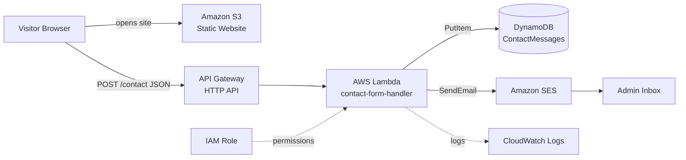

# 📬 Serverless Contact Form with Email Notification

A responsive contact form hosted on **Amazon S3** that sends each submission through **API Gateway** to a **Lambda** function. Lambda saves the message in **DynamoDB** and emails the admin through **Amazon SES**. There are no servers to manage, and the project costs almost nothing to run.

> **Level:** Beginner to Intermediate  |  **Region used:** Asia Pacific (Mumbai) `ap-south-1`

---

## 📑 Table of Contents

1. [Overview](#-overview)
2. [Problem Statement](#-problem-statement)
3. [AWS Services Used](#-aws-services-used)
4. [Architecture](#-architecture)
5. [How It Works](#-how-it-works)
6. [Prerequisites](#-prerequisites)
7. [Repository Structure](#-repository-structure)
8. [Step-by-Step Guide](#-step-by-step-guide)
9. [Testing](#-testing)
10. [Cost](#-cost)
11. [Security Best Practices](#-security-best-practices)
12. [Cleanup](#-cleanup)
13. [Troubleshooting](#-troubleshooting)
14. [Future Improvements](#-future-improvements)
15. [What You Will Learn](#-what-you-will-learn)

---

## 📌 Overview

Visitors fill in a form (name, email, subject, message). When they click **Send**:

1. The browser sends the data as JSON to an **API Gateway** endpoint.
2. **Lambda** validates the data and stores it in **DynamoDB**.
3. Lambda sends an **email notification** to the admin using **SES**. The visitor's address is set as *Reply-To*, so the admin can answer with one click.
4. The visitor sees a success message on the page.

---

## ❗ Problem Statement

A normal contact form needs a server running 24 × 7, a database, and an email service. For a college club or small website this is costly and hard to maintain.

| Traditional approach | This project |
|---|---|
| A server runs all day, even with no visitors | Code runs only when someone submits the form |
| You manage the OS, patches, and scaling | AWS manages everything |
| Monthly fixed cost | Pay per use, usually within the free allowance |

---

## 🧰 AWS Services Used

| Service | Role in this project |
|---|---|
| **Amazon S3** | Hosts the static website (HTML, CSS, JS) |
| **Amazon API Gateway (HTTP API)** | Public HTTPS endpoint `POST /contact`; handles CORS and throttling |
| **AWS Lambda** | Validates input, saves it, and sends the email |
| **Amazon DynamoDB** | Stores every submission (NoSQL table) |
| **Amazon SES** | Sends the notification email to the admin |
| **AWS IAM** | Gives Lambda least-privilege access to DynamoDB and SES |
| **Amazon CloudWatch** | Lambda logs for debugging |

---

## 🏗 Architecture



**Text version:**

```
Browser ──► S3 (website)
   │
   └──► API Gateway ──► Lambda ──┬──► DynamoDB (save message)
                                 ├──► SES ──► Admin email
                                 └──► CloudWatch Logs
```

---

## ⚙ How It Works

1. The page loads from the **S3 website endpoint**.
2. `script.js` checks the fields in the browser and sends `POST /contact` with JSON.
3. **API Gateway** checks CORS and forwards the request to Lambda.
4. **Lambda** validates again (never trust the browser) and ignores bots that fill the hidden *honeypot* field.
5. Lambda writes the item to **DynamoDB** with a unique `id` and a UTC `createdAt` timestamp.
6. Lambda calls **SES** to email the admin. If the email fails, the message is still saved and the error is logged.
7. Lambda returns `200` with a success message, and the page shows it.

**Item stored in DynamoDB:**

```json
{
  "id": "6f1c0a52-...",
  "createdAt": "2026-11-18T09:30:12+00:00",
  "status": "new",
  "name": "Test User",
  "email": "test@example.com",
  "subject": "Hello",
  "message": "This is a test message."
}
```

---

## ✅ Prerequisites

- A working AWS account (verified, with a payment method added)
- Region set to **Asia Pacific (Mumbai) ap-south-1** for every service except IAM (global)
- An email address you can open (used as the SES sender and admin)
- A text editor and a browser

---

## 📁 Repository Structure

```
aws-serverless-contact-form/
├── README.md
├── frontend/
│   ├── index.html        # Contact form page
│   ├── style.css         # Responsive styling (light and dark)
│   └── script.js         # Sends the form to API Gateway (set API_URL here)
├── lambda/
│   └── lambda_function.py
├── iam/
│   └── lambda-policy.json    # Least-privilege policy (replace placeholders)
├── s3/
│   └── bucket-policy.json    # Public read policy (replace the bucket name)
├── tests/
│   └── test-event.json       # Test event for the Lambda console
└── screenshots/
```

---

## 🚀 Step-by-Step Guide

Do the steps in this order. Each step creates something the next one needs.

### Step 1: Create the DynamoDB table

1. Open **DynamoDB → Tables → Create table**.
2. **Table name:** `ContactMessages`
3. **Partition key:** `id` (type **String**)
4. Under **Table settings**, choose **Customize settings**, then **Capacity mode → On-demand**.
5. Click **Create table** and wait until the status is **Active**.

📸 *Add screenshot: `screenshots/01-dynamodb-table.png`*

---

### Step 2: Verify your emails in Amazon SES

New SES accounts start in **sandbox mode**. In sandbox you can send only **to and from verified addresses**, so verify the addresses you will use.

1. Open **Amazon SES** (check the region is Mumbai).
2. Go to **Configuration → Identities → Create identity**.
3. Choose **Email address**, enter your email (for example `yourname@gmail.com`), and click **Create identity**.
4. Open your inbox (also check **Spam**) and click the **verification link** from AWS.
5. Back in SES, confirm the identity status is **Verified**.
6. If the sender and admin are different addresses, verify **both**. Using the same address for both is fine for this project.

📸 *Add screenshot: `screenshots/02-ses-verified.png`*

---

### Step 3: Create the IAM policy and role

**Policy**

1. Open **IAM → Policies → Create policy → JSON** tab.
2. Paste the content of [`iam/lambda-policy.json`](iam/lambda-policy.json) and replace:
   - `<YOUR_ACCOUNT_ID>` with your 12-digit account ID (click your account name at the top-right to see it)
   - `<SENDER_EMAIL>` with your verified SES sender address
3. **Policy name:** `ContactFormPolicy` → **Create policy**.

**Role**

1. Go to **IAM → Roles → Create role** → **AWS service** → **Lambda** → **Next**.
2. Attach **both** policies: `ContactFormPolicy` and `AWSLambdaBasicExecutionRole`.
3. **Role name:** `ContactFormLambdaRole` → **Create role**.

📸 *Add screenshot: `screenshots/03-iam-role.png`*

---

### Step 4: Create the Lambda function

1. Open **Lambda → Create function → Author from scratch**.
2. **Function name:** `contact-form-handler`
3. **Runtime:** Python 3.12 (or the latest Python)
4. **Execution role:** *Use an existing role* → `ContactFormLambdaRole`
5. Click **Create function**.
6. In the **Code** tab, replace the sample code with [`lambda/lambda_function.py`](lambda/lambda_function.py) and click **Deploy**.
7. Go to **Configuration → General configuration → Edit** and set **Timeout = 15 seconds**.
8. Go to **Configuration → Environment variables → Edit** and add:

   | Key | Value |
   |---|---|
   | `TABLE_NAME` | `ContactMessages` |
   | `SENDER_EMAIL` | your verified sender address |
   | `ADMIN_EMAIL` | your verified admin address |

9. Click **Save**.

📸 *Add screenshot: `screenshots/04-lambda-function.png`*

> Run the first test (see [Testing, Test 1](#test-1-test-the-lambda-function-alone)) before moving on. If this works, the backend is correct.

---

### Step 5: Create the API Gateway (HTTP API)

1. Open **API Gateway → Create API**, find **HTTP API**, and click **Build**.
2. Click **Add integration**, choose **Lambda**, and select `contact-form-handler`.
3. **API name:** `contact-form-api` → **Next**.
4. **Routes:** set **Method** `POST` and **Resource path** `/contact`. Confirm the integration target is your Lambda. → **Next**.
5. **Stages:** keep `$default` with **Auto-deploy** on → **Next** → **Create**.
6. Copy the **Invoke URL** from the API details, for example:
   `https://abc123xyz.execute-api.ap-south-1.amazonaws.com`
   Your full endpoint is that URL plus `/contact`.

**Enable CORS** (needed so the browser may call the API from your website):

1. In the API, open **CORS** in the left menu → **Configure**.
2. Fill in:

   | Field | Value |
   |---|---|
   | Access-Control-Allow-Origin | Your S3 website URL (from Step 6), e.g. `http://my-bucket.s3-website.ap-south-1.amazonaws.com` (no trailing `/`). For a first quick test you may use `*`. |
   | Access-Control-Allow-Methods | `POST`, `OPTIONS` |
   | Access-Control-Allow-Headers | `content-type` |
   | Access-Control-Max-Age | `300` |

3. Click **Save**.

**(Recommended) Limit abuse:** open **Stages → `$default` → Edit** under *Default route throttling* and set a low limit such as **Rate 5, Burst 10**.

📸 *Add screenshots: `screenshots/05-api-gateway.png`, `screenshots/06-cors.png`*

---

### Step 6: Host the website on S3

**Prepare the code**

1. Open [`frontend/script.js`](frontend/script.js) and set `API_URL` to your full endpoint, including `/contact`:
   ```js
   const API_URL = "https://abc123xyz.execute-api.ap-south-1.amazonaws.com/contact";
   ```

**Create the bucket**

1. Open **S3 → Create bucket**.
2. **Bucket name:** must be globally unique, for example `contact-form-mithil-2026`.
3. **Region:** Asia Pacific (Mumbai).
4. Under **Block Public Access settings**, **untick "Block all public access"** and tick the warning acknowledgement. This is needed only because this bucket is a public website.
5. Click **Create bucket**.

**Enable website hosting**

1. Open the bucket → **Properties** → scroll to **Static website hosting → Edit**.
2. Choose **Enable**, set **Index document** to `index.html`, and **Save changes**.
3. Copy the **Bucket website endpoint** shown there.

**Make the files public to read**

1. Open **Permissions → Bucket policy → Edit**.
2. Paste [`s3/bucket-policy.json`](s3/bucket-policy.json) and replace `<YOUR_BUCKET_NAME>` with your bucket name. **Save**.

**Upload the website**

1. Open the **Objects** tab → **Upload** → add `index.html`, `style.css`, and `script.js` (the three files, not the folder).
2. Click **Upload**.

**Go back to API Gateway → CORS** and make sure the allowed origin matches your website endpoint exactly (see Step 5).

Open the **Bucket website endpoint** in your browser. You should see the contact form.

> The S3 website endpoint uses **HTTP**. For HTTPS and a custom domain, add Amazon CloudFront in front of the bucket (see [Future Improvements](#-future-improvements)).

📸 *Add screenshots: `screenshots/07-s3-hosting.png`, `screenshots/08-website.png`*

---

## 🧪 Testing

Test from the inside out, so you know exactly which part fails.

### Test 1: Test the Lambda function alone

1. In Lambda, open `contact-form-handler` → **Test** tab → **Create new event**.
2. **Event name:** `contact-test`. Paste the content of [`tests/test-event.json`](tests/test-event.json).
3. Click **Save**, then **Test**.
4. **Expected result:**
   ```json
   { "statusCode": 200, "body": "{\"message\": \"Thank you! Your message has been received.\", \"id\": \"...\"}" }
   ```
5. Check DynamoDB: **Tables → ContactMessages → Explore table items**. A new item should appear.
6. Check your inbox (and Spam) for the email **[Contact Form] Hello from Lambda test**.

### Test 2: Test the API Gateway endpoint

From a terminal (replace the URL with yours):

```bash
curl -X POST "https://abc123xyz.execute-api.ap-south-1.amazonaws.com/contact" \
  -H "Content-Type: application/json" \
  -d '{"name":"Curl Test","email":"curl@example.com","subject":"API test","message":"Testing the API from the command line."}'
```

**Expected:** `{"message": "Thank you! Your message has been received.", "id": "..."}`

On Windows PowerShell, use a tool such as Postman, or:

```powershell
Invoke-RestMethod -Method Post -Uri "https://abc123xyz.execute-api.ap-south-1.amazonaws.com/contact" -ContentType "application/json" -Body '{"name":"PS Test","email":"ps@example.com","subject":"API test","message":"Testing the API from PowerShell."}'
```

### Test 3: Test the full website

1. Open your S3 website endpoint.
2. Fill in the form with valid data and click **Send message**.
3. **Expected:** a green success message, the form clears, a new DynamoDB item appears, and an email arrives.

### Test 4: Validation (negative tests)

| Test | Input | Expected result |
|---|---|---|
| Empty name | name = `` | Error: please enter your name |
| Bad email | email = `abc` | Error: please enter a valid email |
| Short message | message = `Hi` | Error: at least 10 characters |
| Invalid JSON | `curl ... -d 'not json'` | `400` Invalid request |

### Test 5: Honeypot (bot protection)

Send a request that fills the hidden field:

```bash
curl -X POST "<YOUR_API_URL>/contact" -H "Content-Type: application/json" \
  -d '{"name":"Bot","email":"bot@example.com","message":"I am a bot message.","website":"spam"}'
```

**Expected:** a normal success response, but **no new item** in DynamoDB and **no email**.

### Test 6: Check the logs

Open **CloudWatch → Log groups → `/aws/lambda/contact-form-handler`** and open the latest log stream. You should see lines such as `Saved submission ...` and `Email sent for submission ...`.

📸 *Add screenshots: `screenshots/09-dynamodb-item.png`, `screenshots/10-email-received.png`, `screenshots/11-cloudwatch-logs.png`*

### Quick checklist

| Test | Pass condition |
|---|---|
| Lambda test event | `statusCode: 200`, item saved, email received |
| API with curl | JSON success response |
| Website form | Green success message |
| Validation tests | `400` with a clear message |
| Honeypot | Success shown, nothing saved or emailed |
| Logs | Save and email lines present |

---

## 💰 Cost

All services used here have a free allowance or very low prices for this usage:

- **Lambda, API Gateway, DynamoDB (on-demand), CloudWatch:** a workshop's traffic is tiny.
- **S3:** a few KB of files.
- **SES:** very low per-email pricing.

> Always check current pricing and Free Tier terms at [aws.amazon.com/free](https://aws.amazon.com/free), since they change over time. Set a **Zero spend budget** or a small monthly budget in AWS Budgets as a safety net.

---

## 🔐 Security Best Practices

- ✅ **Least privilege:** Lambda can only write to one table and send mail only from one verified address.
- ✅ **Server-side validation:** the backend checks every field, even though the browser also does.
- ✅ **CORS restricted** to your website origin (use `*` only for quick tests).
- ✅ **Throttling** on the API to limit abuse.
- ✅ **Honeypot field** to filter simple bots.
- ✅ **Email subject cleaned** of line breaks to prevent header injection.
- ✅ **Plain-text emails**, so visitor text is never treated as HTML.
- ⚠️ The S3 bucket is public **only because it hosts a public website**. Never put private files in it.
- ❌ Never put AWS access keys in `script.js` or anywhere in the repo.
- ❌ Do not commit screenshots showing your account ID or email addresses. Blur them first.

---

## 🧹 Cleanup

Delete resources after the workshop:

1. **S3:** open the bucket, click **Empty**, then **Delete** the bucket.
2. **API Gateway:** delete `contact-form-api`.
3. **Lambda:** delete `contact-form-handler`.
4. **CloudWatch:** delete the log group `/aws/lambda/contact-form-handler`.
5. **DynamoDB:** delete the `ContactMessages` table.
6. **IAM:** delete the role `ContactFormLambdaRole` and the policy `ContactFormPolicy`.
7. **SES:** delete the verified identity (optional).

---

## 🛠 Troubleshooting

| Problem | Likely cause | Fix |
|---|---|---|
| Browser console shows a **CORS error** | The allowed origin does not match your site URL | In API Gateway → CORS, set the exact S3 website URL (no trailing `/`), methods `POST, OPTIONS`, header `content-type` |
| Page says "API URL is not configured" | `API_URL` still has the placeholder | Edit `script.js`, set the real endpoint, and upload it to S3 again |
| `403 Forbidden` when opening the website | Bucket is not public or the policy is wrong | Untick Block Public Access, check the bucket policy name, and confirm `index.html` is uploaded |
| `AccessDenied` for DynamoDB in logs | Wrong account ID or table name in the policy | Fix the ARN in `ContactFormPolicy` |
| `AccessDenied` for SES in logs | `ses:FromAddress` does not match `SENDER_EMAIL` | Make both exactly the same verified address |
| `MessageRejected: Email address is not verified` | SES sandbox: sender or admin not verified | Verify both addresses in SES (Mumbai region) |
| Success shown but no email | Email in Spam, or SES error | Check Spam and the CloudWatch logs; the message is still in DynamoDB |
| `500 Server configuration error` | Missing environment variables | Add `TABLE_NAME`, `SENDER_EMAIL`, `ADMIN_EMAIL` in Lambda |
| `Task timed out` | Default 3-second timeout | Set the timeout to 15 seconds |
| Old behaviour after editing code | Lambda was not deployed | Click **Deploy** after pasting the code |
| `404` from the API | Wrong path or method | Use `POST` and the path `/contact` |

---

## 🔮 Future Improvements

- 🌐 Put **CloudFront** in front of S3 for HTTPS, speed, and a custom domain (with ACM and Route 53)
- 🛡 Add **AWS WAF** or a CAPTCHA for stronger spam protection
- 📤 Send an **auto-reply** email to the visitor (needs SES production access)
- 📊 Build an **admin page** to list and mark messages as read (API Gateway + Cognito)
- 📑 **Export submissions to Excel/CSV** from DynamoDB
- 🚀 Request **SES production access** to email unverified addresses
- 🧱 Rebuild the project as **Infrastructure as Code** (AWS SAM, CloudFormation, or Terraform)

---

## 🎓 What You Will Learn

- Building a **serverless backend** with API Gateway and Lambda
- Designing a simple **NoSQL table** in DynamoDB
- Sending email with **Amazon SES** and understanding sandbox mode
- Hosting a **static website** on S3
- Fixing **CORS** problems
- Applying **IAM least privilege** with conditions
- Debugging with **CloudWatch Logs**
- Basic web **security**: validation, throttling, honeypot

---

## 👥 Contributors

Built by the **AWS Student Builders Group**, **LJIET**.

| Name | Role |
|---|---|
| Mithil Dave | Project author |

---

## 📄 License

This project is for educational purposes. Feel free to fork, learn, and improve it.
